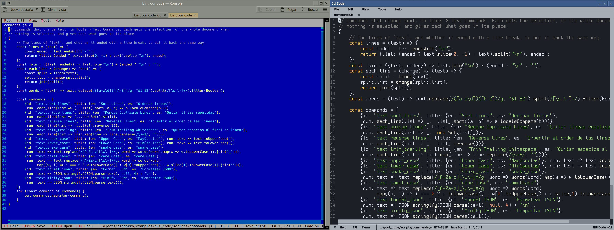

# OUI Code



Three programs made with [OUI](https://github.com/iganinja/olagarro), each the same program in a terminal, over SSH
too, and in a window of its own:

- **OUI Code**, a text editor and file explorer: syntax colouring, several cursors, find in files, a project tree, a
  terminal in a tab, Markdown preview, file comparison, and languages, commands and tools written in JavaScript.
- **oui_run**, which runs JavaScript the way node does, with OUI's widgets for scripts that want a window.
- **oui_calc**, a calculator: a prompt that works out what is written on it, as `(800*0.16) - (0.32*500)` or
  `interest = 800*0.03`, and keeps it in a log.

## Install

One line in a terminal, for your system:

**Linux and macOS**

```sh
curl -fsSL https://raw.githubusercontent.com/iganinja/oui_code/master/install.sh | sh
```

**Windows**, in PowerShell

```powershell
irm https://raw.githubusercontent.com/iganinja/oui_code/master/install.ps1 | iex
```

**Debian, Ubuntu and the like**, kept up to date by `apt upgrade`

```sh
curl -fsSL https://raw.githubusercontent.com/iganinja/oui_code/master/install.sh | sh -s -- --apt
```

Or download them from the [releases](https://github.com/iganinja/oui_code/releases).

### What the installers do

They show what there is and ask, then download it, check it against the release's sums and install it, with no
root and no administrator but for `--apt`: in `~/.local/bin` on Linux and macOS, and on Windows in
`%LOCALAPPDATA%\Programs\oui_code`, which they add to the PATH. There are programs for Linux and Windows on x86-64,
for Linux on 64-bit ARM, as a Raspberry Pi 3, 4 or 5 with a 64-bit system, and for macOS on Apple's processors and
Intel's.

Each program comes in two kinds, under the same name: for the terminal, and `gui`, which also opens in a window of
its own. Typed in a terminal it stays there, and `--window` opens its window; started from the desktop's menu or an
icon, with no terminal, it opens its window. The installers can also get the whole package, the three programs with
their licences, and take options to choose without asking: `sh -s -- --all --gui` on Linux and macOS, `-All -Gui` on
Windows, as the head of each script tells.

### APT by hand

`--apt` adds the project's APT repository and its key, with sudo, and installs from it; this is the same by hand:

```sh
sudo mkdir -p /etc/apt/keyrings
sudo curl -fsSL https://iganinja.github.io/oui_code/oui_code.gpg -o /etc/apt/keyrings/oui_code.gpg
echo "deb [signed-by=/etc/apt/keyrings/oui_code.gpg] https://iganinja.github.io/oui_code stable main" \
    | sudo tee /etc/apt/sources.list.d/oui_code.list
sudo apt update && sudo apt install oui-pack
```

`oui-pack` has the three for the terminal and `oui-pack-gui` the `gui` ones, which also puts OUI Code and OUI Calc in
the desktop's menu; one or the other, in `/usr/bin`. `apt upgrade` brings each new release. Each release also carries
them as `.deb` files, for `sudo dpkg -i`.

## Scripts

oui_run runs JavaScript files as programs: `console.log` writes to the terminal, commands run with their output as it
comes, and the program ends when the script and what it started are done. Scripts are modules and import each other
with relative paths. A script that wants more opens a window with `oui.window()` and builds it from OUI's widgets, in
the terminal or, in the `gui` kind with `--window`, on the desktop.

[Scripting](doc/scripting.md) shows how things are done and [the API reference](doc/oui_api.md) lists every name;
[`oui.d.ts`](oui.d.ts) has the same as TypeScript declarations, which editors read. `oui_run/hello.js` is a plain
script and `oui_run/demo.js` a small panel; `oui_run/recipes` has whole scripts for common jobs, as searching and
replacing in files, CSV and JSON, a command's output or renaming, and `oui_run/programs` small programs: the game
2048, a process viewer, a file browser and a to-do list. The same scripts, as far as they use files, commands and
questions, run inside OUI Code too.

## Building

OUI comes as a git submodule:

```sh
git clone --recurse-submodules https://github.com/iganinja/oui_code.git
```

Linux and macOS, with CMake, Ninja, a C++17 compiler and GoogleTest (`libgtest-dev`, or `brew install googletest`):

```sh
tools/build.sh           # the terminal programs, bin/oui_code and the rest, built in build/ and tested
tools/build.sh --gui     # those able to open in a window too, bin/oui_code_gui and the rest, in build-gui/
```

[Building](doc/building.md) has the options, the small static binaries a release carries, and Windows;
[Testing](doc/testing.md) the suites, the end-to-end tests that drive the programs in a pseudo terminal, and how to
run one case. How OUI Code is put together, for whoever changes it, is in [OUI Code](doc/oui_code.md); its user
manual is [its help](oui_code/help/help.md), which F1 opens.

A release is made by pushing a version's tag, as `v0.4.0`: GitHub's release workflow tests it, builds the programs for
each system and kind with `tools/build_portable.sh`, publishes the files `tools/package_release.sh` makes of them, and
puts the Debian packages in the APT repository on GitHub Pages.

## Licence

zlib, as OUI, in [LICENSE](LICENSE). What the programs carry of others' keeps its own licence, listed in each
release's `THIRD_PARTY_NOTICES.txt`.
